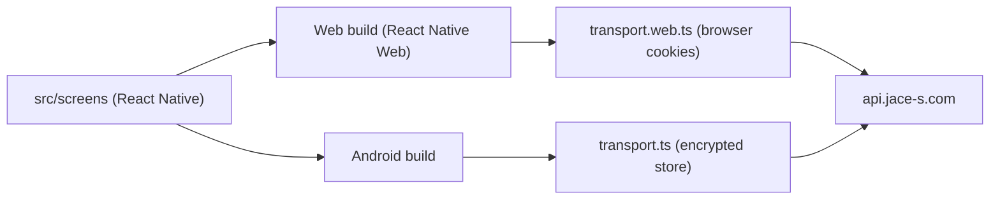

# Overview

## Single Screen Codebase
Every screen is written once with React Native components. Expo builds the web app through React Native Web and the Android app natively. Platform differences live only in files with a `.web.ts(x)` suffix: the HTTP transport and the Google button.

## Platform Boundary
- The platform repository owns accounts, permissions, notices and the progress API (`/companions/english/*`), and serves the web build as the `english` container behind the gateway.
- This repository owns screens, word content and the Android build.

Example: a learner signs in on japanese.jace-s.com, then opens english.jace-s.com in the same browser. The API session cookie is shared, so the English app starts signed in.

## Responsive Presentation

The shared Expo screens select desktop or compact composition from available logical dimensions. Browser and Android use one screen tree; session and storage adapters remain platform specific. See [Responsive Layout Design](../design/app/30-responsive-layout.md).

## Reading Materials

ReadingLibrary renders prose and vocabulary management alongside the existing study screens. ReaderText uses native word actions or inline keyboard accessible web buttons. Account session transports call the platform reading API, which uses the serialized companion account store. Japanese definitions and notes reuse curriculum SQL; English vocabulary and notes use its account library. Server segmentation supplies the same word boundaries to web and native. See [Reading Books](../design/app/40-reading-books.md).
