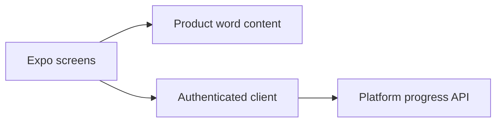

# Data Flow

The common Expo screens display product word content with account progress from the platform. Progress changes use the authenticated English Companion endpoints. The platform also owns notices and account permissions.

See [Architecture Overview](10-overview.md).
