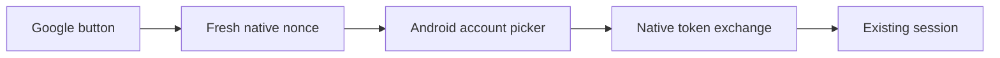

# English Companion Design

- Spec: [English Companion](../../specs/app/10-english-companion.md)
- Architecture: [Overview](../../architecture/10-overview.md#single-screen-codebase)
- All scenarios: [English Companion Scenarios](../../testing/scenarios/app/10-english-companion.md#english-companion-scenarios)

## Screens And Flow
- Input: Validated units, the account progress map and the account date.
- Output: Rendered screens; graded results passed to the save call.
- Code: `src/App.tsx` (gate, tab, session and display state), `src/screens/HomeScreen.tsx` (`HomeScreen`, `HomeTab`), `Dashboard.tsx` (`Stats`, `StageChart`, `RecentUnits`, `UnitGrid`, `ProgressPanel`, `UnitCard`), `SessionScreen.tsx` (`SessionScreen`, `SessionStart`), `SettingsScreen.tsx`, `LoginScreen.tsx`; helpers `summarizeUnit`, `dueWords`, `quizWords`, `sentenceOrder` and `grade` in `src/domain/study.ts`, and `buildUnitRows`, `buildQueue`, `stageBuckets`, `relativeDay`, `MAX_STAGE` and `STAGE_LABELS` in `src/domain/dashboard.ts`.
- Steps: `restore` → `bootstrap` (permission and clock) → `progress` → today tab. A learning card opens a session with the unit's words in study; a review card opens a quiz-only session with the unit's due words. The last quiz answer leads to the result step → `saveResults` merges the returned entries into the progress map.
- `buildUnitRows` derives per-unit started, due, wrong, pass ratio, graduation and latest date from the progress map; `buildQueue` takes units with due words and the first unit with unstarted words. No server data is added (D-0004 in the platform decision log).
- Layout and parts: see [Responsive Layout](30-responsive-layout.md#presentation).
- Scenario: Unit with two quizzed words → study both → answer both → save → home shows two started words.

## Quiz Scratch Memo
- Input: Text typed on a quiz question.
- Output: Nothing persisted; the value lives only in component state.
- Code: `QuizMemo` in `src/screens/SessionScreen.tsx`, rendered with `key={word.id}` so it remounts empty whenever the question changes.

## Account Screen
- Input: `EnglishClient`, busy and error state from `App`, and back, logout and expired callbacks.
- Output: Account details, a My Page link, a sign-out button and display settings.
- Code: `src/screens/SettingsScreen.tsx` exports `SettingsScreen`; `src/api/client.ts` `EnglishClient.account()` reads `/auth/session` and returns `Account` (`src/api/types.ts`) with `hasLocalPassword` defaulting to true when absent. `src/App.tsx` shows it as the settings tab and reuses the existing `logout`. `src/display.ts` exports `Display`, `DEFAULT_DISPLAY`, `parseDisplay`, `readDisplay` and `writeDisplay`, keeping theme and layout mode in browser storage or secure storage on Android.
- A 401 while loading returns to the login screen with the session-ended notice.
- Scenario: A Google-only account opens the account screen and sees "Google 전용", then signs out and lands on the login screen.

## Content
- Input: `src/content/words.json` (`{version: 1, units: [...]}`).
- Output: `EnglishUnit[]`, or a `ContentError` naming the invalid path.
- Code: `parseContent` in `src/content/content.ts`. Word IDs match `^[a-z0-9][a-z0-9-]{0,63}$` and are unique across units; a quiz has exactly four sentences and an `answer` index from 0 to 3.

## Progress And API
- Input: Graded results `{id, result}`.
- Output: Updated progress entries `{stage, due, lastResult, updatedAt}`.
- Code: `EnglishClient` in `src/api/client.ts` calls `/auth/session`, `/auth/login`, `/auth/google/*`, `/app-access/english`, `/auth/clock`, `/companions/english/progress` and `/companions/english/save-results`. Requests are serialized and a 401 clears local credentials. Writes send `x-companion-user` so results cannot be saved to a different account after an account change.
- Transports: `createNativeTransport` in `src/api/transport.ts` captures the `session` and `csrf` cookies into `expo-secure-store` and sends them explicitly. `createBrowserTransport` in `src/api/transport.web.ts` uses `credentials: "include"` and the CSRF token returned in response bodies. Metro selects the `.web.ts` file for the web build.
- The server applies review intervals on its own account date.

## Platform Components
- `src/components/GoogleButton.web.tsx` renders Google Identity Services into the DOM element of a React Native Web `View`; the native `GoogleButton.tsx` renders nothing.
- `src/components/Notices.tsx` reads `/health` and `/notices` and shows the titles in one dismissible toast (one bulleted line per notice when there are several, never stacked toasts), or the fixed text "Unable to connect to the server." when the API is unreachable and no notice exists. `src/components/noticeToast.ts` `resolveNoticeToast` decides the toast: it closes after 8 seconds while the API is reachable and stays until closed otherwise (tests: `tests/notices.test.ts`). Example: reachable with two notices gives one toast with two lines that closes after 8 seconds.

## Android Native Build
- Input: Expo configuration and installed Android SDK and JDK.
- Output: Generated Android projects and `dist-android/english-companion-android.apk`.
- Code: `scripts/build-android.mjs` and `plugins/with-short-cmake-path.cjs`.
- The config plugin adds a root Gradle rule for application and library Android plugins. During DSL finalization each project receives a separate `.cxx/<project-name>` staging directory and `CMAKE_OBJECT_PATH_MAX=250`, including Expo modules compiled from source. This keeps CMake outputs outside the deeply nested dependency directories without modifying dependencies.
- Reference: [CMake object path limit](https://cmake.org/cmake/help/v3.22/variable/CMAKE_OBJECT_PATH_MAX.html) describes the hashing of object paths above the configured limit.
- Scenario: Build under a nested Windows checkout with Expo modules compiled from source. Both the app and Expo libraries use the short staging paths and the release APK is copied only after Gradle succeeds.
- Guide: [Build](../../guides/10-development.md#build)
- All scenarios: [Windows Native Build](../../testing/scenarios/app/10-english-companion.md#windows-native-build)

## Native Google Implementation

- Inputs: Runtime web Client ID, remember selection, server native nonce and official picker credential.
- Outputs: Existing account session or null on cancellation and stale callbacks; safe localized errors on failure.
- Code: `src/components/GoogleButton.tsx`, `src/components/nativeGoogleFlow.ts`, `src/api/client.ts` and the locked package dependencies. Android SDK autolinking is used; web resolves GoogleButton.web.tsx without loading the native SDK.
- Public contracts: NativeGoogleClient supplies config, nativeGoogleChallenge and nativeGoogleLogin; NativeGoogleProvider supplies Play Services checks, configuration and explicit account selection. signInWithNativeGoogle checks liveness between asynchronous steps, configures the fresh nonce with autoSelectOnSignIn false, and exchanges successful credentials only. GoogleButton disables duplicate submissions and ignores unmounted results.
- The client obtains POST /auth/google/native/challenge, then sends credential, nonce, remember and local timeZone to POST /auth/google/native. Existing native transport persists session and CSRF cookies in encrypted storage. Browser cookie challenges are unchanged.
- Representative scenario input: Picker cancellation followed by retry. Steps: Cancel once and open again. Expected result: No first exchange and a new nonce for the second attempt.
- Spec: [Companion requirements](../../specs/app/10-english-companion.md#android-google-account-picker)
- Architecture: [Overview](../../architecture/10-overview.md)
- Scenarios: [Authentication cases](../../testing/scenarios/app/10-english-companion.md#native-google-contracts)

## Restored Presentation

The common screen implementation restores responsive desktop and compact compositions and the product visual identity. Layout and theme details: [Responsive Layout](30-responsive-layout.md).
