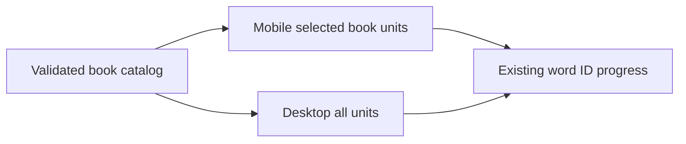
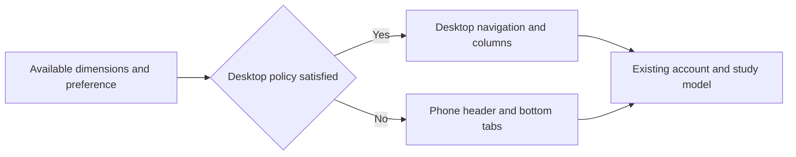

# Responsive Layout Design

- Spec: [Responsive Layout](../../specs/app/30-responsive-layout.md)
- Architecture: [Overview](../../architecture/10-overview.md)
- Scenarios: [Responsive Layout](../../testing/scenarios/app/30-responsive-layout.md)

## Layout Policy
- Input: `useWindowDimensions()` width and height in logical pixels, and existing manual device preference where supported.
- Output: Desktop or compact composition without changing the screen model or creating an Android specific screen tree.
- Code: `src/responsive.ts` exports `isDesktopLayout(width, height, mode)`. Auto requires width >= 1024 and min(width, height) >= 600. Phone and PC preferences explicitly override auto. `App.tsx` reads dimensions and passes the layout to the shell and dashboard. Study and quiz screens retain a bounded reading width.
- Each product owns its copy of the small policy because product builds cannot import sibling repositories.

## Presentation
- Inputs: Active tab, navigation callbacks, current account date, existing dashboard data and theme.
- Output: Accessible selected tabs, desktop navigation and dashboard columns, compact mobile navigation, themed cards and real progress counts.
- Code: `src/` modules `Chrome.tsx, ui.tsx, screens/Dashboard.tsx, screens/HomeScreen.tsx, screens/SessionScreen.tsx`. `Chrome` renders navigation without owning account or study state.
- The parts are copies of the Japanese Companion parts (`ui.tsx`: `T`, `Card`, `Btn`, `Action`, `Chip`, `Meter`, `Switch`, `CopyId`, `Segment`, `Input`, `Field`, `Empty`, `Spinner`, `Sheet`, `Toast`, plus `Theme`, `Device`, `palettes`, `fonts`, `gradient`, `layout`); each product keeps its own copy. Older `colors` and `styles` remain for the Google button and notices.
- Library palette: dark `#0f1513` background, `#16201c` panels, brass `#d9b45a` accent, ivy `#6fbf8e` for passes, sky `#7fb3d9` for reviews and `#e57b6e` for failures; light uses parchment `#f5f1e6` with `#8a6a1c`. Words and sentences use a serif face.
- `Chrome` shows the "Aa" brand mark, the today, Unit, progress and settings tabs and the due-unit count. The screens keep the empty-content state and never invent vocabulary or progress.
- The root view paints one radial brass glow sized to the viewport, so it never repeats while scrolling.

## Mobile Book Selection
- Input: `EnglishBook[]`, selected book ID and onBookChange from App, and desktop layout state.
- Output: A mobile-only full-width selector above today, Unit and progress; desktop controls and all-unit presentation stay unchanged.
- Code: `src/BookSelect.tsx` exports `BookSelect`, using a labelled native HTML select on web and the existing themed Sheet with radio options on Android. Minimum control and option touch height is 44 pixels; empty lists disable selection. `src/screens/HomeScreen.tsx` renders it only when desktop is false.
- Scenario: At 390x844 choose the second book. Steps: Update App selection and rebuild dashboard rows from that book's units. Expected result: Its Unit list and totals appear; resizing to 1440x900 restores the original all-unit desktop view with no dropdown.
- All scenarios: [Mobile Book Dropdown](../../testing/scenarios/app/30-responsive-layout.md#mobile-book-dropdown).

## Representative Scenario
- Input: Home at 1280 by 800, followed by 915 by 412.
- Steps: Read dimensions, evaluate the policy, reflow the existing components.
- Expected result: Desktop navigation and columns become compact tabs and stacked cards without resetting application state.

## Browser Control Theme
- Input: Active palette and explicit dark or light scheme from App.
- Output: Theme-colored thin browser scrollbars and matching native browser control colors, with unchanged screen composition.
- Code: `src/BrowserTheme.tsx` exports BrowserTheme beside `src/BookSelect.tsx`. App mounts it within the active Theme provider; it renders browser-only CSS and returns null on native platforms. Japanese signed-out screens use the default dark palette.
- Scrollbar thumb uses dim, track uses panel, and hover uses muted. Standard scrollbar properties and WebKit fallback rules cover the supported browser renderers; operating-system popup menus remain browser-managed.
- BookSelect keeps the actual select element, hides its edge-bound default arrow and paints an encoded theme-colored SVG chevron at right 14px center. Right padding is 40px; native selection sheets are unchanged.
- Example input: Change dark to light while a long book title is selected. Steps: Re-render BrowserTheme with the current palette. Expected result: Browser control and scrollbar colors update immediately, and the inset arrow leaves room for the title.
- Scenarios: [Themed Browser Controls](../../testing/scenarios/app/30-responsive-layout.md#themed-browser-controls).
