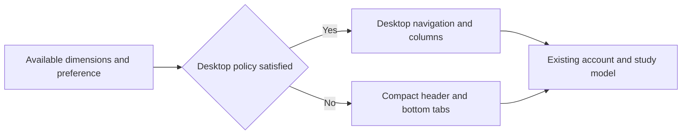

# Responsive Layout Design

- Spec: [Responsive Layout](../../specs/app/30-responsive-layout.md)
- Architecture: [Overview](../../architecture/10-overview.md)
- Scenarios: [Responsive Layout](../../testing/scenarios/app/30-responsive-layout.md)

## Layout Policy
- Input: `useWindowDimensions()` width and height in logical pixels, and existing manual device preference where supported.
- Output: Desktop or compact composition without changing the screen model or creating an Android specific screen tree.
- Code: `src/responsive.ts` exports `isDesktopLayout(width, height, mode)`. Auto requires width >= 1024 and min(width, height) >= 600. Phone and PC preferences explicitly override auto. `App.tsx` reads dimensions and passes the layout to the shell and dashboard. Study and quiz screens retain a bounded reading width.
- Each product owns its copy of the small policy because product builds cannot import sibling repositories.

## Presentation
- Inputs: Active tab, navigation callbacks, current account date, existing dashboard data and theme.
- Output: Accessible selected tabs, desktop navigation and dashboard columns, compact mobile navigation, themed cards and real progress counts.
- Code: `src/` modules `Chrome.tsx, ui.tsx, screens/HomeScreen.tsx`. `Chrome` renders navigation without owning account or study state; HomeScreen consumes the existing study model. Theme primitives style existing settings, study and quiz screens too.
- English HomeScreen retains its empty-content state and never invents vocabulary or progress; its meter clamps the displayed percentage. English `Chrome` switches between home and account using the existing view state.
- All backgrounds are opaque native colors; no document-sized repeated background image is used.

## Representative Scenario
- Input: Home at 1280 by 800, followed by 915 by 412.
- Steps: Read dimensions, evaluate the policy, reflow the existing components.
- Expected result: Desktop navigation and columns become compact tabs and stacked cards without resetting application state.

