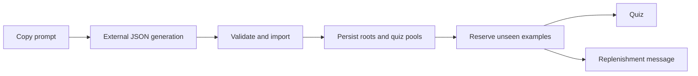

# English Vocabulary Design

- Spec: [Requirements](../../specs/app/50-english-vocabulary.md)
- Architecture: [Overview](../../architecture/10-overview.md)
- Scenarios: [Cases](../../testing/scenarios/app/50-english-vocabulary.md)

## Contracts
- Input: Account identity, book ID, versioned imported words, roots, provided examples, question pools and quiz request identity.
- Output: Stable word IDs, persistent roots, imported-set counts, reserved unseen quiz choices or an exhaustion result.
- Code: Platform englishWordSchema.ts, englishVocabulary.ts, readingLibrary.ts and companion routes; English englishImport.ts, VocabularyImport.tsx, RootBrowser.tsx and SessionScreen.tsx.
- Preserve existing word IDs, progress and unique personal notes. Legacy example and single quiz fields remain readable.
- Store materials, roots and display history in the existing serialized account library. Reserve all four sentences before returning a question, including abandoned sessions. Retry the same request ID to obtain the same reservation. Return a replenishment state when no unseen set remains.
- Root browsing derives groups from persisted word root fields. It does not infer etymology from spelling.

## Example
- Input: Two simultaneous quiz requests for the same word.
- Steps: Serialize account mutations, reserve the first unseen set, then inspect remaining sentence history.
- Output: Distinct sets or exhaustion; the same request ID remains idempotent.

## Persistence And Compatibility
- Existing materials remain in data/apps/english-reading per-account JSON files through companionDataStore; roots and quizzes are fields of each persisted word, not device-only state. usedExamples stores original displayed sentences by normalized spelling; quizRequests caches the last 100 idempotent reservations while display history remains permanent.
- parseEnglishWord normalizes roots and checks question structure and duplicates. parseEnglishImport accepts versioned JSON with an optional surrounding code fence. importEnglishVocabulary drops consumed sets from the active pool while keeping their permanent history, then appends fresh sets and roots without replacing existing word IDs, meanings, provided examples or learner notes. updateEnglishLibrary serializes this with normal book editing.
- exampleKey hashes case, punctuation and spacing normalized sentences for comparison. reserveEnglishQuiz excludes provided study examples, personal examples and all prior reserved choices, handles simultaneous requests serially, and treats old fixed quizzes with recorded progress as already seen.
- RootBrowser and groupWordsByRoot group only persisted etymological roots. VocabularyImport uses expo-clipboard following the Japanese importer pattern. buildEnglishImportPrompt includes the target book and prior example history but never personal notes.
- SessionScreen requests a reservation only on entering quiz mode; study mode never consumes a set. The same mounted session reuses its reserved questions when navigating, while a new session requests fresh sets. Exhausted words are ungraded and show replenishment instructions.

## Source Paths And Validation
- Platform code paths: services/api/src/services/companions/englishWordSchema.ts, services/api/src/services/companions/englishVocabulary.ts, services/api/src/services/companions/readingLibrary.ts and services/api/src/routes/companions.ts.
- English code paths: src/englishImport.ts, src/VocabularyImport.tsx, src/RootBrowser.tsx, src/ReadingLibrary.tsx, src/readingWords.ts, src/content/content.ts, src/api/client.ts, src/screens/HomeScreen.tsx and src/screens/SessionScreen.tsx.
- Schema exports EnglishQuiz, EnglishVocabularyError, exampleKey, studyExampleKeys and parseEnglishWord. studyExampleKeys excludes both full provided-example lines and individual sentences, including lowercase sentence starts. Target-word validation uses word boundaries instead of substring matching.
- Legacy fixed quizzes keep a legacyQuiz marker during ordinary edits so recorded old progress cannot turn an old example into a fresh question. Replenishment moves already seen legacy choices to durable history before clearing that marker.
